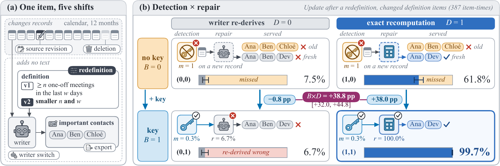

# MemShift: Separating Detection from Repair in LLM-Derived Personal Memory

<!-- Add the paper link (arXiv) to this row when the preprint is out. -->
[](https://huggingface.co/datasets/zichuanxu/memshift)
[](LICENSE)
[](https://creativecommons.org/licenses/by/4.0/)
[](pyproject.toml)

MemShift is a benchmark for memories that store values a language model derived from a person's
records. After five controlled shifts of synthetic worlds, it reports for every changed item
whether the memory noticed the change (detection) and, if so, whether the new value is right
(repair). Every answer is scored by typed matching, without an LLM judge.

<p align="center">
  
</p>

*(a) One knowledge item and the five shifts. (b) The reference memory with and without a key (B,
detection) and with the writer's re-derivation or exact recomputation (D, repair), after a
redefinition: the key pays only when the repair is right.*

## Overview

Each world is one synthetic person's twelve months across six sources (e-mail, calendar, tasks,
contacts, notes, chat), with 48 knowledge items whose gold values and dependencies are fixed before
any text is rendered. A shift forks a world into branches that are identical outside the shift.

| Shift | What changes |
|---|---|
| source revision | records behind about a fifth of the items are revised |
| deletion | the record behind half of the series, task and contact items is deleted |
| redefinition | half of the person's definitions move to a second version, and every record stays the same byte for byte |
| writer switch | the writer model is replaced |
| export | the memory is exported to Portable Memory and imported by a second implementation |

The reference memory, HoldMem, has two settings with known effects. With **the key (B=1)** each item
keeps a key over the events of its sources, its definition version and its writer, and is
invalidated and re-derived when the key changes (B=0 has no key). **D** sets the repair: at D=0 the
writer re-derives an invalidated item, and at D=1 exact recomputation computes it as gold does (for
43 of the 48 items). An accounting identity splits accuracy after a shift into what the key misses,
what re-derivation repairs and what the memory serves without invalidating.

## Main results

With four open-weight models from four families as writer and reader, a key is worth what repair
adds: after a redefinition or a deletion, the key gains more with exact recomputation than with the
writer's re-derivation for every model (Table 4b of the paper).

| Contrast (pp) | Llama-3.1-8B | gemma-4-12B | gpt-oss-20b | Qwen3.5-9B |
|---|---|---|---|---|
| B effect on Update, source revision | +29.6 [+25.1, +34.1] | +9.5 [+5.5, +13.6] | +12.2 [+8.0, +16.6] | +7.8 [+4.4, +11.7] |
| D effect on accuracy, source revision | +20.4 [+18.0, +23.1] | +13.1 [+11.6, +14.6] | +12.0 [+10.5, +13.5] | +13.7 [+12.5, +15.2] |
| D effect on accuracy, redefinition | +40.0 [+36.1, +43.3] | +31.9 [+28.4, +35.0] | +26.5 [+23.7, +29.5] | +33.6 [+31.2, +36.3] |
| B×D on Update, source revision | +4.2 [-4.2, +13.1] | +0.8 [-2.1, +3.8] | +12.6 [+9.6, +16.5] | +6.2 [+2.5, +10.3] |
| B×D on Update, redefinition | +20.8 [+11.7, +29.4] | +14.4 [+8.3, +20.1] | +28.5 [+23.1, +32.8] | +27.1 [+22.9, +32.1] |
| B×D on Update, deletion † | +26.4 [+20.5, +31.9] | +7.8 [+4.9, +10.7] | +13.0 [+9.8, +15.4] | +5.0 [+1.7, +8.1] |
| No-store BM25 − HoldMem(1,1), redefinition | -50.5 [-53.3, -48.4] | -36.3 [-40.1, -32.3] | -30.1 [-33.2, -27.2] | -45.1 [-48.6, -42.2] |

Contrasts in percentage points, with 95% world-bootstrap intervals in brackets, on the same 10 test
worlds for every model († for Qwen3.5-9B, the 20 worlds of the main study). B effect: the source key
against no key, pooled over D. D effect: exact recomputation against the writer's re-derivation, on
the accuracy on re-derived items, changed or not. B×D: the interaction on Update, the share of
changed items answered correctly. The last row compares a reader that searches the raw records with
BM25 and keeps no store with HoldMem(1,1).

<details>
<summary>Per item class with Qwen3.5-9B (Table 4a): repair fails on the items computed by the person's definitions</summary>

| Shift | Items | Share (%) | r_0 (%) | r_1 (%) | a_0 (%) | a_1 (%) | B×D, caused by the shift (pp) | B×D, all (pp) |
|---|---|---|---|---|---|---|---|---|
| source revision | definition | 28.5 | 16.3 | 99.7 | 10.2 | 65.8 | +24.3 [+12.5, +35.7] | +27.3 [+21.6, +32.6] |
| source revision | other | 71.5 | 89.1 | 90.7 | 83.7 | 85.9 | -1.0 [-4.7, +2.0] | -0.6 [-3.8, +2.5] |
| redefinition | definition | 69.4 | 6.7 | 100.0 | 7.5 | 61.8 | +38.7 [+30.4, +46.9] | +38.8 [+32.0, +44.8] |
| redefinition | other | 30.6 | 73.1 | 73.1 | 70.8 | 71.3 | — | -0.6 [-4.0, +2.7] |
| deletion | definition | 17.4 | 11.8 | 100.0 | 4.2 | 56.5 | +39.6 [+15.0, +60.0] | +35.4 [+30.4, +40.0] |
| deletion | other | 82.6 | 68.1 | 67.5 | 10.0 | 10.9 | -1.5 [-5.9, +2.5] | -1.4 [-5.4, +2.3] |

On the 20 test worlds of the main study, on changed items with the source key. Share is the class's
share of the changed items. r_D is repair correctness at D with a key (the share of invalidated
changed items whose re-derived value is right, with detection counted from the latest change) and
a_D is Update at D without a key (the share of changed items answered correctly). B×D is the
interaction on Update, on the changed items that the shift caused and on all changed items. The
source key missed at most 0.6% of a class's changed items, so the identity gives the interaction
approximately as (r_1 - a_1) - (r_0 - a_0). Definition items are the six items of each world
computed by the person's definitions, other items the remaining 42, and — marks that a redefinition
itself changes no other item. Given every record of a definition, a Claude writer comes close to
exact recomputation.

</details>

`scripts/readme_results.py` checks both tables, and the 0.6% above, against the numbers that
`make results` recomputes.

## Installation

MemShift needs Python 3.12 or later and [uv](https://docs.astral.sh/uv/).

```bash
uv sync --dev                    # the environment of uv.lock
uv sync --dev --extra native     # adds the Mem0, Graphiti and Portable Memory adapters
```

A-Mem, Cognee, HippoRAG 2, LightRAG and MemOS run in their own Docker images, built with
`scripts/build_native.sh SYSTEM` from `docker/native/SYSTEM.txt`. The figure generator renders text
with LaTeX, so it needs a TeX installation with the `newtx` fonts.

## Quick start

Generating worlds and running the tests needs no GPU and no model. Worlds regenerate byte for byte
from their seeds ([check against a released run](docs/REPRODUCE.md#worlds-and-tests)).

```bash
make smoke                                                 # generate one world branch and check its SHA256 ("manifest OK")
uv run memshift gen --seed 1000 --branch src --out worlds  # one test world, source-revision branch
make check                                                 # ruff, mypy and pytest (about 45 minutes)
```

## Evaluating your own memory system

A memory system reaches the benchmark through `src/memshift/adapters`. The drivers give it source
events in time order, ask it for evidence at each probe and pass that evidence to the shared reader
within a 4,096-token budget. A system that keeps no derived state implements `serve(probe)`, like
the baselines in `adapters/baselines.py`. A system with its own store subclasses `NativeSystem`
(`adapters/native.py`), and the adapters for Mem0, Graphiti, A-Mem, Cognee, HippoRAG 2, LightRAG
and MemOS are worked examples. Register the class in `NATIVE` in `src/memshift/experiments/e5.py`
and run it on the short worlds:

```bash
uv run python -m memshift.experiments.e5 --seeds 1000-1014 --months 3 --systems mysystem \
    --on-error skip
```

[docs/REPRODUCE.md](docs/REPRODUCE.md#evaluating-your-own-memory-system) lists the methods to
implement and how a system is compared with the HoldMem cell of its (D, B) label and plain RAG.

## Reproducing the paper

Every number, table and figure of the paper rebuilds on a CPU without calling a model.
[docs/REPRODUCE.md](docs/REPRODUCE.md) gives every step, the repository layout and a map from each
table and figure of the paper to its generator, staged analysis and experiment driver.

- **Tier 1 (CPU, no model).** `make results` rebuilds the reported numbers, tables and figures from
  the merged analyses in `runs/` in about one minute, and then checks the tables above. A few cells
  also read the raw outputs from Hugging Face, and with them `memshift.analysis.stage` rebuilds each
  merged analysis from its runs.
- **Tier 2 (GPUs).** Serve the models with vLLM 0.30.0 at the revisions in
  [docs/COMPUTE.md](docs/COMPUTE.md), point `.env` at the servers and rerun an experiment from its
  seeds, for example the main experiment on the 20 test worlds:

```bash
uv run python -m memshift.experiments.e1 --seeds 1000-1019 --discriminative \
    --branches src,def,orphan \
    --cells D0B0,D1B0,D0B1_source,D1B1_source,D0B1_cited,D1B1_cited --name e1_test
```

The model servers held the GPUs for about 140 A100 GPU-hours in all. The response caches on Hugging
Face hold every model reply, so a rerun with the recorded settings reuses them instead of calling
the models again.

## Data

- **Worlds and gold labels** are not stored. They regenerate from their seeds: development worlds
  0-9, calibration worlds 900-909, test worlds 1000-1019 and replication worlds 1020-1039. A world is
  identified by its seed and the generator version. Seeds 1000-1039 are evaluation seeds, so a system
  tuned on them is not comparable.
- **Run metadata** is in `runs/`: every run's `manifest.json` and `env.json`, and the merged
  analyses of the stages ([runs/README.md](runs/README.md)).
- **Raw outputs** are in the Hugging Face dataset
  [`zichuanxu/memshift`](https://huggingface.co/datasets/zichuanxu/memshift): answers, probes,
  items, call logs and response caches of every run, at the same paths as here. Download it into
  the root of this checkout ([contents](docs/REPRODUCE.md#raw-outputs)). The dataset card describes
  every file type and field.
- **Audits.** `audit/` holds the system audit and the neighbour audit
  ([audit/README.md](audit/README.md)).

## Citation

```bibtex
@misc{xu2026memshift,
  title  = {{MemShift}: Separating Detection from Repair in {LLM}-Derived Personal Memory},
  author = {Xu, Zichuan and Zhang, Haochen and Dong, Yuyang and Onizuka, Makoto and Xiao, Chuan},
  year   = {2026},
  note   = {Preprint}
}
```

`CITATION.cff` holds the same reference for GitHub's citation button.

## License

- Code: MIT ([LICENSE](LICENSE)).
- Data (generated worlds, gold labels, model outputs, audit data): CC BY 4.0. Model outputs are also
  subject to the terms of the model that produced them. The dataset card lists them.
- The open-weight models and the third-party memory systems are not redistributed and keep their
  own licenses.

## Contact

Please open a GitHub issue for questions and bug reports.
